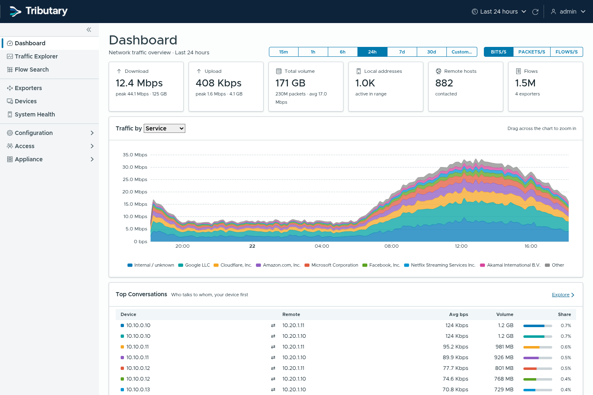

# Tributary

*Self-hosted network flow analytics: NetFlow, IPFIX and sFlow.*



Tributary collects flow data from routers, switches and firewalls, stores it in
ClickHouse, and serves dashboards, drill-down analysis and flow search from a
single Go binary with a web UI.

## Features

- NetFlow v5/v9, IPFIX and sFlow v5, with sampling correction
- Dashboard, traffic explorer, Sankey path analysis and flow search
- A query language with suggestions as you type, saved queries, and an
  optional AI assistant that writes queries from plain English
- GeoIP, ASN, MAC vendor and reverse DNS enrichment; names from NetBox
- SNMP polling for interface names and speeds
- Scheduled PDF reports by email
- Webhook and Telegram notifications
- Threat-feed matching (Spamhaus DROP, Feodo Tracker, FireHOL, or your own lists)
- Sign-in with local accounts, OIDC, SAML, LDAP/AD or RADIUS, plus TOTP
- Encrypted backups, scheduled to SMB, S3 or SFTP
- Audit log with syslog forwarding
- Read-only [MCP](docs/MCP.md) endpoint for AI assistants

More in [docs/FEATURES.md](docs/FEATURES.md) and
[docs/SCREENSHOTS.md](docs/SCREENSHOTS.md).

## Install

Debian or Ubuntu, amd64. Download the `.deb` and `install.sh` from the
[latest release](https://github.com/kochlabs/tributary/releases/latest), then:

```bash
sudo ./install.sh tributary_<version>_amd64.deb
```

The installer adds ClickHouse's apt repository and prints the initial admin
password. See [docs/INSTALL.md](docs/INSTALL.md) for manual installation and
how ClickHouse is configured.

## Documentation

- [Installation](docs/INSTALL.md)
- [Features](docs/FEATURES.md)
- [Architecture](docs/ARCHITECTURE.md)
- [Databases](docs/DATABASE.md)
- [Queries](docs/QUERIES.md)
- [AI assistant](docs/AI.md)
- [Reports](docs/REPORTS.md)
- [Notifications](docs/NOTIFICATIONS.md)
- [Threat feeds](docs/THREAT-FEEDS.md)
- [MCP](docs/MCP.md)
- [Development](docs/DEVELOPMENT.md)
- [Translating](docs/TRANSLATING.md)

## License

[AGPL-3.0-or-later](LICENSE). See [NOTICE](NOTICE) and
[THIRD_PARTY_NOTICES.md](THIRD_PARTY_NOTICES.md). Default GeoIP data:
[IP Geolocation by DB-IP](https://db-ip.com),
[CC BY 4.0](https://creativecommons.org/licenses/by/4.0/).
