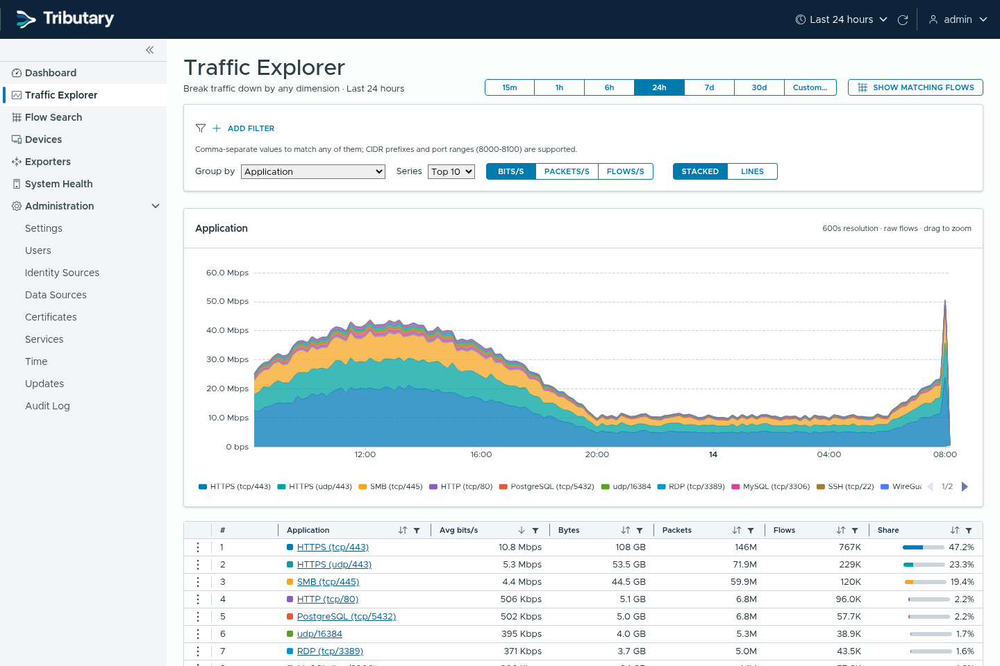
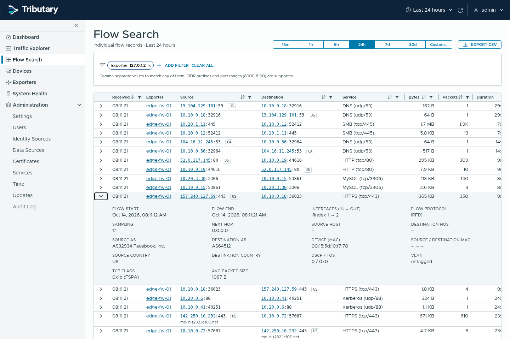
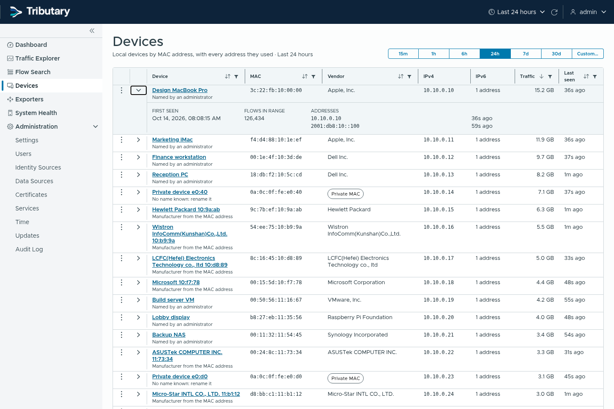
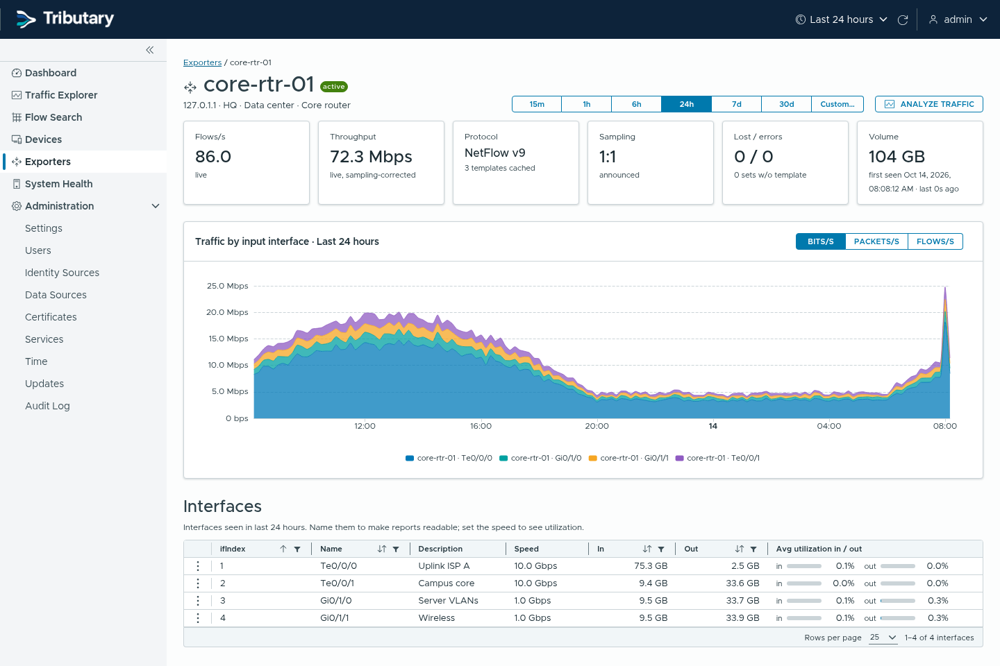
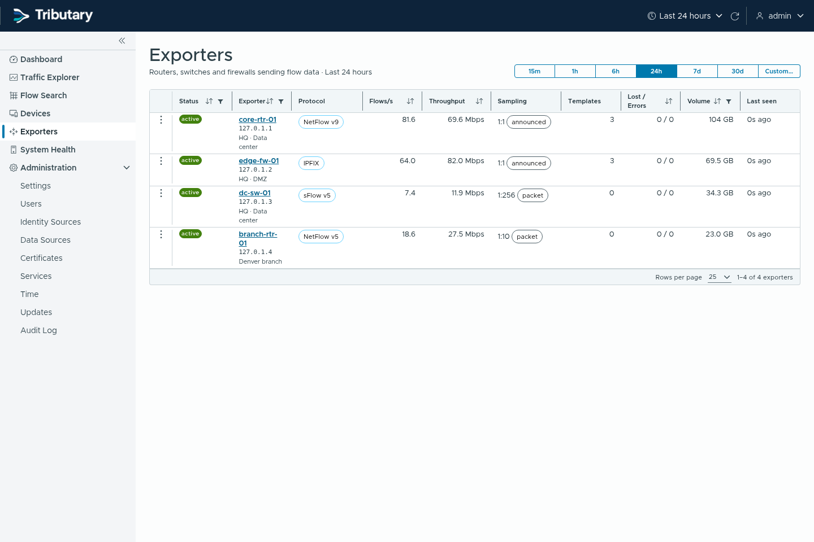
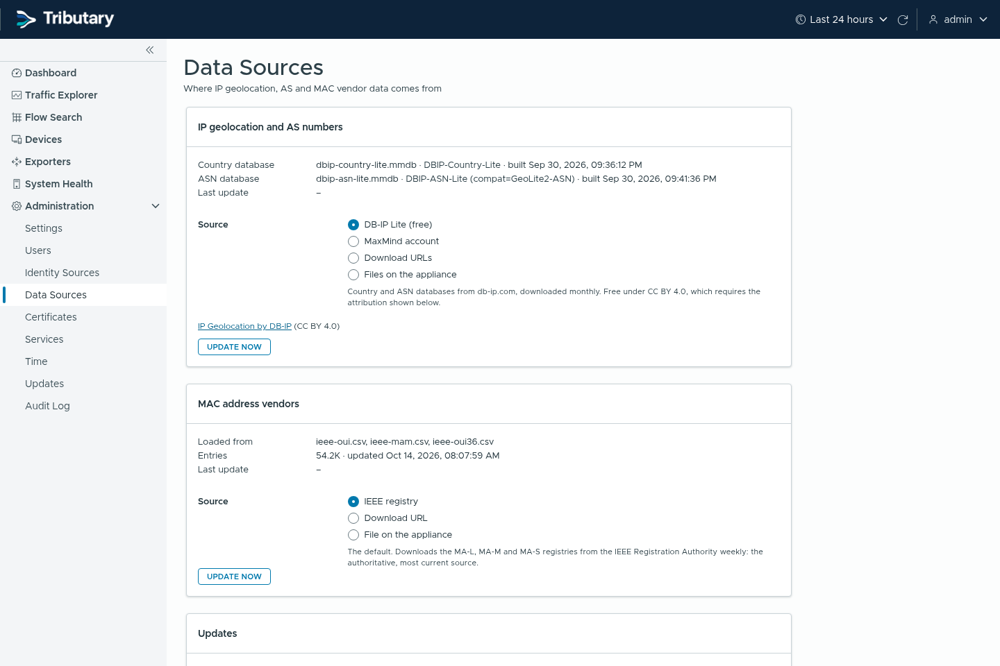
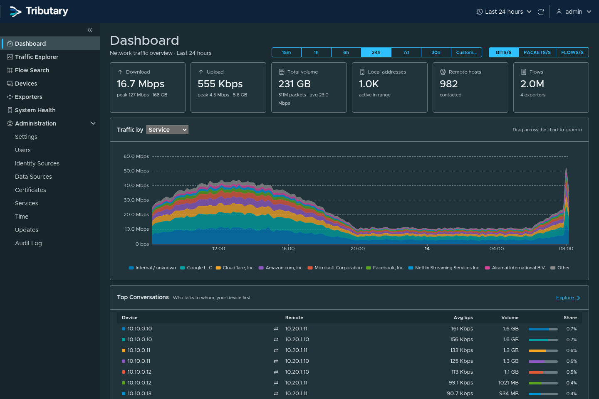

# Tributary

*Network flow analytics appliance.*

A self-contained flow collector and traffic analytics appliance: NetFlow v5/v9,
IPFIX and sFlow v5 in; dashboards, drill-down analysis and flow search out,
with an enterprise UI built on [Clarity](https://clarity.design/).


## Screenshots

| | |
|---|---|
|  **Traffic Explorer**: break traffic down by any dimension and filter, drag to zoom |  **Flow Search**: individual flow records with full detail, paging and CSV export |
|  **Devices**: local devices identified by MAC address, with vendor and every address they used |  **Exporter detail**: live counters, sampling, and per-interface traffic and utilization |
|  **Exporters**: every router, switch and firewall sending flows, with health at a glance |  **Data Sources**: choose where GeoIP, ASN and MAC vendor data comes from |
|  **Dark theme** |  **Sign in**: local accounts or single sign-on (OpenID Connect) |

Screenshots show simulated traffic from `cmd/flowgen`.

## Architecture

```
 routers / switches / firewalls
        │  UDP 2055 (NetFlow) · 4739 (IPFIX) · 6343 (sFlow)
        ▼
 ┌─────────────────────────── nfad (single Go binary) ───────────────────────────┐
 │ SO_REUSEPORT receivers ─► decoders ─► GeoIP/ASN enrich ─► batching writer ──┐  │
 │ (one socket per CPU)     (v5/v9/IPFIX/sFlow,              (non-blocking,    │  │
 │                           template + sampling cache)       drop-counted)    │  │
 │ REST API + embedded Angular/Clarity UI (HTTPS, sessions, RBAC, audit) ◄─┐   │  │
 └─────────────────────────────────────────────────────────────────────────┼───┼──┘
                                   SQLite: users, settings, names ─────────┘   ▼
                                   ClickHouse: raw flows (TTL) + 1-min rollup (MV)
```

## Features

- **Collection**: NetFlow v5, v9 (incl. options templates), IPFIX (variable-length
  fields, enterprise IEs skipped safely, NSEL byte counters), sFlow v5 (raw header
  parsing incl. 802.1Q, extended switch/router/gateway records).
- **Sampling**: learned from v5 headers, v9/IPFIX options data (fields 34/50/305/306),
  sFlow sample rates; per-exporter manual override. Volumes are sampling-corrected.
- **Loss detection**: per exporter/observation-domain sequence tracking.
- **Enrichment**: country and ASN (with org names) at ingest. Choose the source
  under Administration → Data Sources: DB-IP Lite (free, the default), a MaxMind
  account (GeoLite2 or licensed GeoIP2 editions), your own download URLs (e.g. a
  DB-IP subscription) or files maintained by `geoipupdate`. MAC vendor names from
  the IEEE registry (the default, refreshed weekly), a URL or a file. Reverse DNS at query
  time with caching and a bounded wait.
- **Analytics**: dashboard, Traffic Explorer (any dimension × any filter, stacked
  series with "Other", drag-to-zoom, URL-shareable views), Flow Search with
  server-side paging/sorting and CSV export, exporter/interface pages with
  utilization.
- **Filters**: IP/CIDR (v4 and v6), ports and ranges, protocol names, AS, country,
  interface, VLAN, DSCP, app (`tcp/443`); comma = OR, `!` prefix = NOT.
- **Appliance**: HTTPS by default (self-signed on first boot), bcrypt + hashed
  session tokens, admin/viewer roles, login rate limiting, audit log, strict CSP,
  retention controls, health page.

## Performance

On a 2 vCPU / 4 GB VM: decoding runs at ~4.4M flows/s per core with zero
allocations (`make bench`); end-to-end ingest sustained 14k flows/s with no drops
while the traffic generator shared the same CPUs. Storage is ~17 bytes per flow
on disk (≈6× compression), so 20 GB holds roughly a billion flows.

## Layout

| Path | Contents |
|---|---|
| `cmd/nfad` | the appliance daemon |
| `cmd/flowgen` | traffic simulator (live UDP export or ClickHouse backfill) |
| `internal/decode` | protocol decoders (+ round-trip tests and fuzzing) |
| `internal/collector` | UDP listeners, per-exporter stats |
| `internal/store` | ClickHouse schema, writer, query builder |
| `internal/enrich` | GeoIP/ASN and reverse DNS |
| `internal/api` | REST API, auth, SPA serving |
| `internal/config` | SQLite config store |
| `web/` | Angular 22 + Clarity 18 front end (embedded into the binary) |
| `deploy/` | systemd unit, install script, ClickHouse/sysctl tuning |

## Build & install

Requires Go 1.27+ and Node 24+ to build. Run `make` to list all targets.

```bash
make deb                 # dist/tributary_<version>_amd64.deb
sudo deploy/install.sh   # adds the ClickHouse apt repo, installs the newest .deb
```

On another Debian/Ubuntu box, copy the `.deb` and `deploy/install.sh` (or add
the ClickHouse repository yourself and `apt install ./tributary_*.deb`). The
package installs:

| Path | Contents |
|---|---|
| `/usr/bin/nfad`, `/usr/bin/tributary-flowgen` | daemon and traffic simulator |
| `/usr/lib/systemd/system/` | `nfad.service`, `tributary-admin.path/.service`, `tributary-update-check.timer` |
| `/usr/lib/tributary/tributary-admin.sh` | root helper for Updates, Time and Services |
| `/etc/tributary/services.conf` | Services page allowlist (conffile) |
| `/etc/clickhouse-server/config.d/tributary.xml` | ClickHouse tuning (conffile) |
| `/var/lib/nfa` | configuration database, TLS certificate, GeoIP data |

The installer prints the initial `admin` password (also in
`/var/lib/nfa/initial-admin-password`). `apt purge tributary` removes
everything except the ClickHouse `netflow` database.

### Development

```bash
make deploy              # build the .deb and install it on this box
make check               # gofmt, vet, tests, web build: run before committing
make dev                 # backend on https://localhost:8443 (admin / admin12345)
make serve               # UI with hot reload on :4200, proxies /api
make demo-start          # simulated exporters on 127.0.1.1–4 (make demo-stop)
bin/flowgen -backfill 72h -geoip-dir /var/lib/nfa/geoip   # history
```

## Operating notes

- Configure exporters with an active timeout of 60 s so long flows are reported
  promptly; traffic is attributed to the time a record is received.
- GeoIP data: "IP Geolocation by DB-IP" (https://db-ip.com), CC BY 4.0. Drop
  `GeoLite2-Country.mmdb` / `GeoLite2-ASN.mmdb` into `/var/lib/nfa/geoip` to use
  MaxMind instead.
- ClickHouse listens on localhost only and runs with a fixed memory cap
  (`deploy/clickhouse/netflow-appliance.xml`).

## License

Tributary is free software, licensed under the
[GNU Affero General Public License v3.0](LICENSE) or later. If you run a
modified version for users over a network, the AGPL requires you to offer them
its source code. See [NOTICE](NOTICE) for attributions, and
[THIRD_PARTY_NOTICES.md](THIRD_PARTY_NOTICES.md) for the licenses of the
bundled components (regenerate it with `make notices`).

The default GeoIP data is
[IP Geolocation by DB-IP](https://db-ip.com), licensed
[CC BY 4.0](https://creativecommons.org/licenses/by/4.0/).
