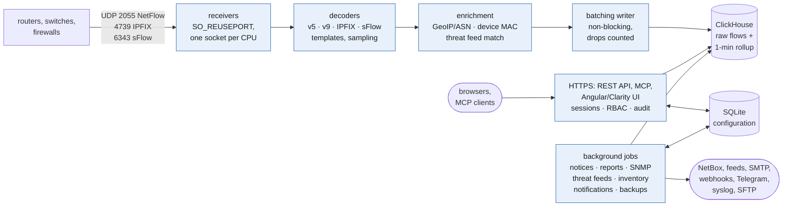

# Architecture

Blue boxes run inside `nfad`, a single Go binary.

Flows are written to `netflow.flows` (raw, partitioned by day) and rolled up
per minute into `netflow.traffic_1m` by a materialized view. Queries over more
than three hours that only need rollup columns (exporter, interfaces, protocol)
read the rollup. Configuration lives in SQLite under `/var/lib/nfa`; both
schemas are in [DATABASE.md](DATABASE.md).
See [INSTALL.md](INSTALL.md#how-clickhouse-is-set-up-for-tributary) for the
ClickHouse setup.

## Source layout

| Path | Contents |
|---|---|
| `cmd/nfad` | the daemon |
| `cmd/flowgen` | traffic simulator (live UDP export or ClickHouse backfill) |
| `internal/decode` | protocol decoders, with round-trip tests and fuzzing |
| `internal/collector` | UDP listeners, per-exporter stats |
| `internal/store` | ClickHouse schema, writer, query builder |
| `internal/enrich` | GeoIP/ASN and reverse DNS |
| `internal/api` | REST API, authentication, UI serving |
| `internal/config` | SQLite configuration store |
| `internal/backup`, `internal/offsite` | backup, restore and scheduled copies |
| `web/` | Angular + Clarity front end, embedded in the binary |
| `deploy/` | packaging, systemd units, install script, ClickHouse and sysctl settings |

## Performance

On a 2 vCPU / 4 GB VM: decoding runs at about 4.4M flows/s per core with no
allocations (`make bench`); ingest sustained 14k flows/s end to end without
drops, with the traffic generator on the same CPUs. Flows take about 17 bytes
each on disk (≈6× compression), so 20 GB holds roughly a billion.
