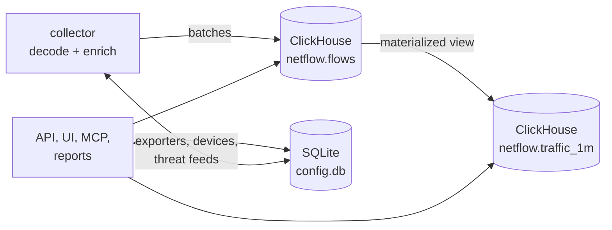
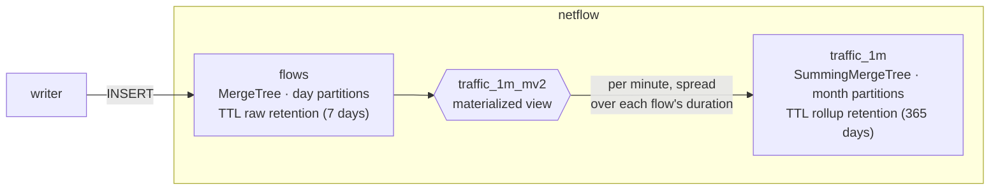
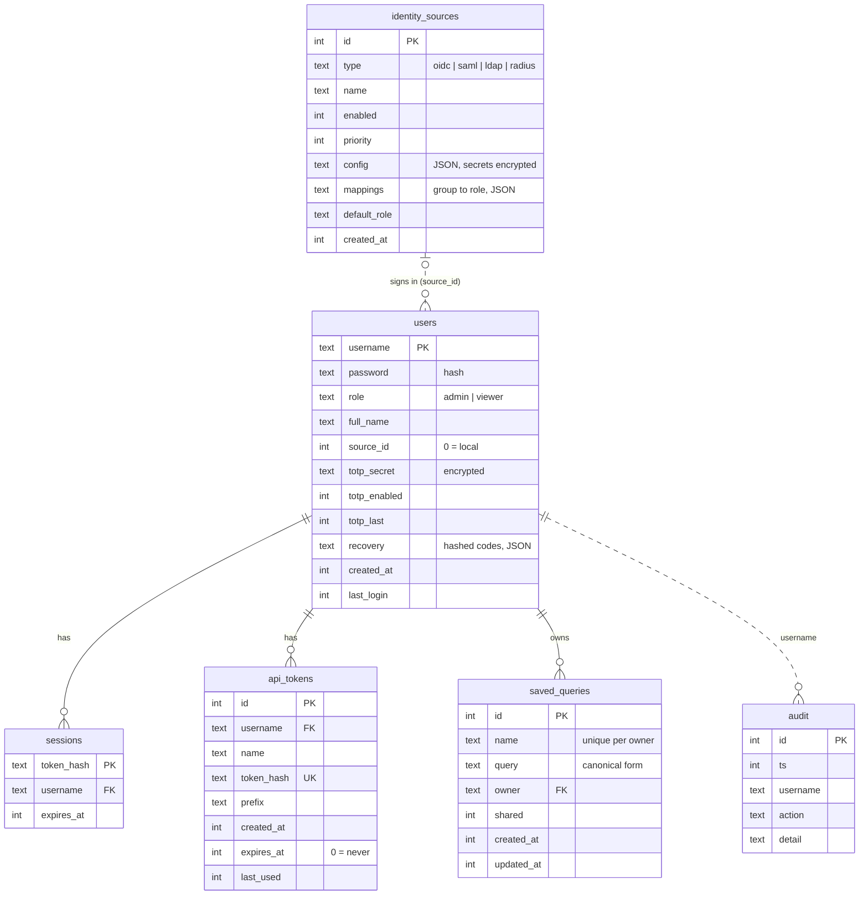
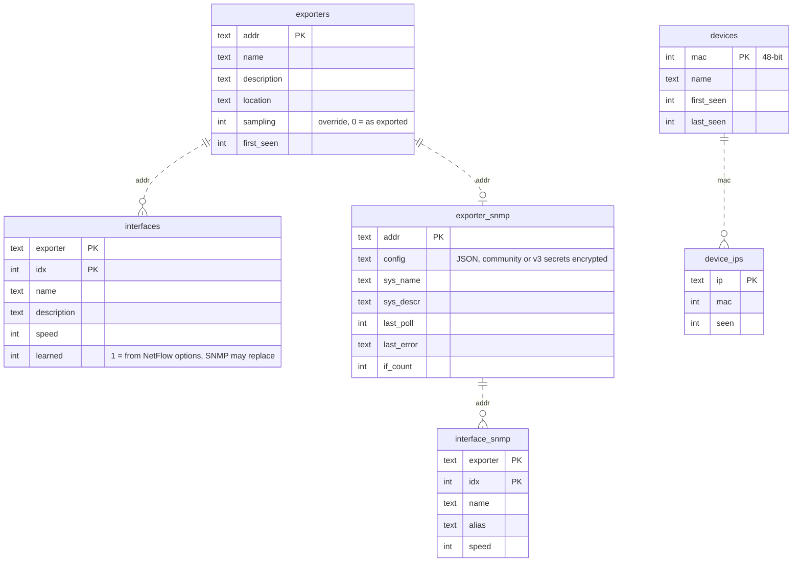
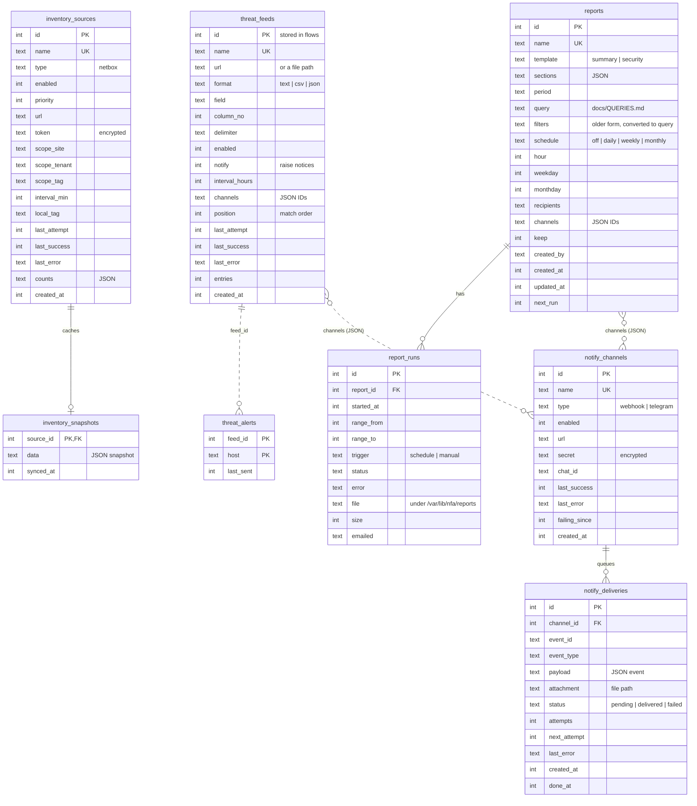

# Databases

Tributary keeps flows in ClickHouse and everything else in SQLite.

Both schemas are created and migrated by `nfad` at start
(`internal/store/store.go`, `internal/config/*.go`); there are no separate
migration files. Migrations only add: columns and tables are never dropped
in place.

## ClickHouse

Database `netflow`, user `netflow` (see
[INSTALL.md](INSTALL.md#how-clickhouse-is-set-up-for-tributary)). Times are
`DateTime('UTC')`; the UI converts to local time.

Retention is set in **Configuration → Settings** and applied with `ALTER
TABLE … MODIFY TTL`.

### `flows`

One row per flow record. Ordered by `(time_received, exporter)`, with bloom
filter indexes on both addresses.

| Column | Type | |
|---|---|---|
| `time_received` | DateTime | when the collector received the record; the partition and sort key |
| `time_start`, `time_end` | DateTime | the flow's own timestamps, from the exporter |
| `flow_type` | UInt8 | 1 NetFlow v5, 2 v9, 3 IPFIX, 4 sFlow v5 |
| `exporter` | IPv6 | the exporter's address (IPv4 as `::ffff:a.b.c.d`) |
| `sampling_rate` | UInt32 | 1 when unsampled |
| `in_if`, `out_if` | UInt32 | SNMP interface indexes |
| `direction` | UInt8 | 0 ingress, 1 egress (v9/IPFIX field 61) |
| `src_addr`, `dst_addr`, `next_hop` | IPv6 | |
| `src_port`, `dst_port` | UInt16 | |
| `proto`, `tcp_flags`, `tos` | UInt8 | |
| `src_as`, `dst_as` | UInt32 | from the exporter, or the ASN database |
| `src_country`, `dst_country` | LowCardinality(String) | ISO 3166 alpha-2, from GeoIP |
| `src_mac`, `dst_mac` | UInt64 | as exported, 48-bit; 0 unknown |
| `device_mac` | UInt64 | the local device the flow belongs to (device tracker) |
| `src_threat`, `dst_threat` | LowCardinality(String) | ID of the threat feed listing the address; empty if none |
| `src_mask`, `dst_mask` | UInt8 | prefix lengths |
| `vlan`, `etype` | UInt16 | |
| `bytes`, `packets` | UInt64 | already multiplied by `sampling_rate` |

Names (exporters, interfaces, devices, threat feeds, inventory) are not
stored in flows: they are looked up when shown, so renaming applies to all
history.

### `traffic_1m`

Per-minute totals by `(ts, exporter, in_if, out_if, proto, etype)`:
`bytes`, `packets`, `flows`. Queries longer than three hours that only use
those dimensions read it instead of `flows`.

## SQLite

`/var/lib/nfa/config.db` in WAL mode, with foreign keys on. Times are Unix
milliseconds. Secrets (bot tokens, passwords for LDAP, SMTP, SNMP and backup
destinations, TOTP seeds, API keys) are encrypted with AES-GCM using
`/var/lib/nfa/secret.key`; passwords, session and API tokens are stored as
hashes. Both files are in backups.

Solid lines are foreign keys; dotted lines are references by value (IDs in
JSON lists, addresses).

### Access

### Exporters and devices

### Threat feeds, inventory, reports and notifications

### Other tables

| Table | |
|---|---|
| `trusted_cas` | CA certificates trusted for LDAP, SAML, NetBox, webhooks (`id`, `name`, `pem`, `sha256`, `created_at`) |
| `settings` | key → JSON value, below |

| `settings` key | |
|---|---|
| `settings` | general settings: retention, ports, appliance name and address, local networks, DNS, exporter allowlist |
| `email` | SMTP server (password encrypted) |
| `syslog` | syslog forwarding |
| `enrichment` | GeoIP / ASN sources (license key encrypted) |
| `backup_schedule`, `backup_run` | scheduled backups and the last run |
| `backup_ssh_key` | the appliance's SSH key for SFTP destinations (encrypted) |
| `ai` | the AI assistant: provider, URL, model, names switch (API key encrypted) |
| `notice_routing` | notice level and channels |
| `notices_sent` | notices sent to channels, until they clear |
| `threat_feeds_seeded` | the default feeds were added once |
| `sampling:<exporter>` | the sampling rate an exporter announced (`/system` when it applies to all its flows) |
