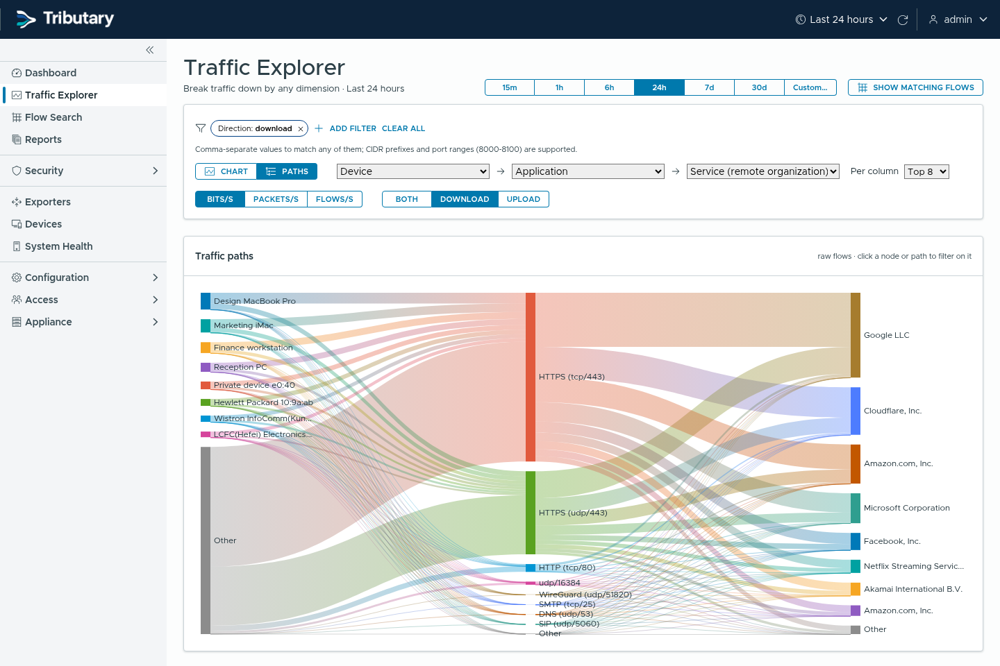
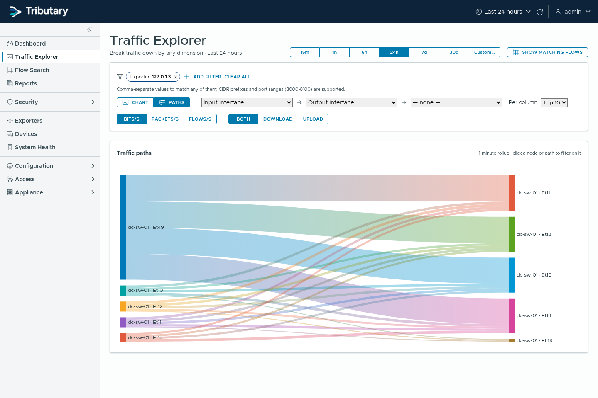
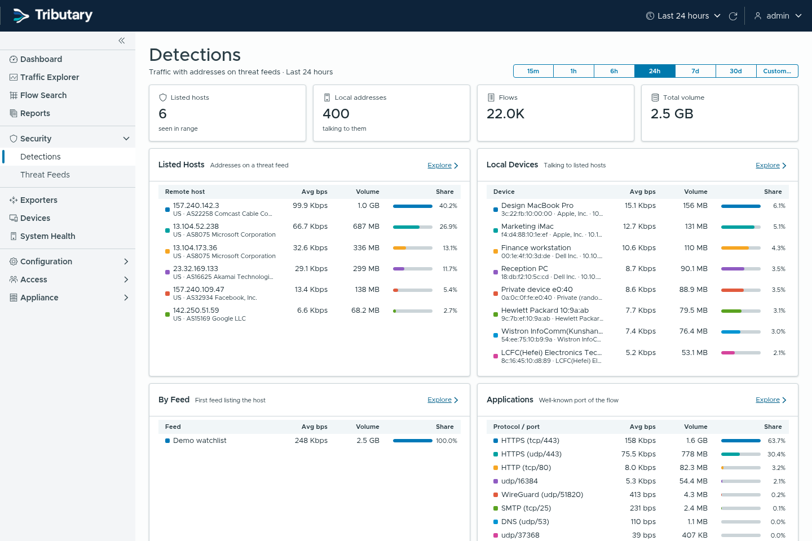
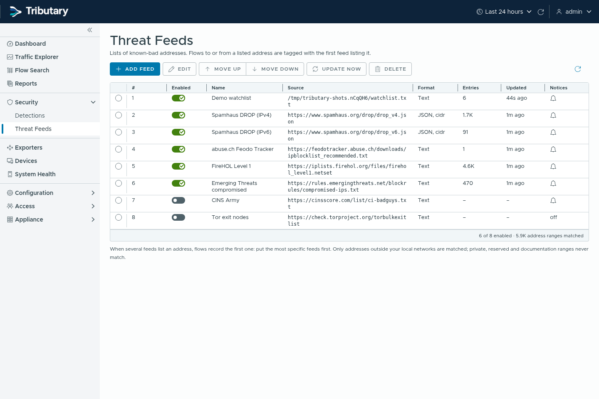
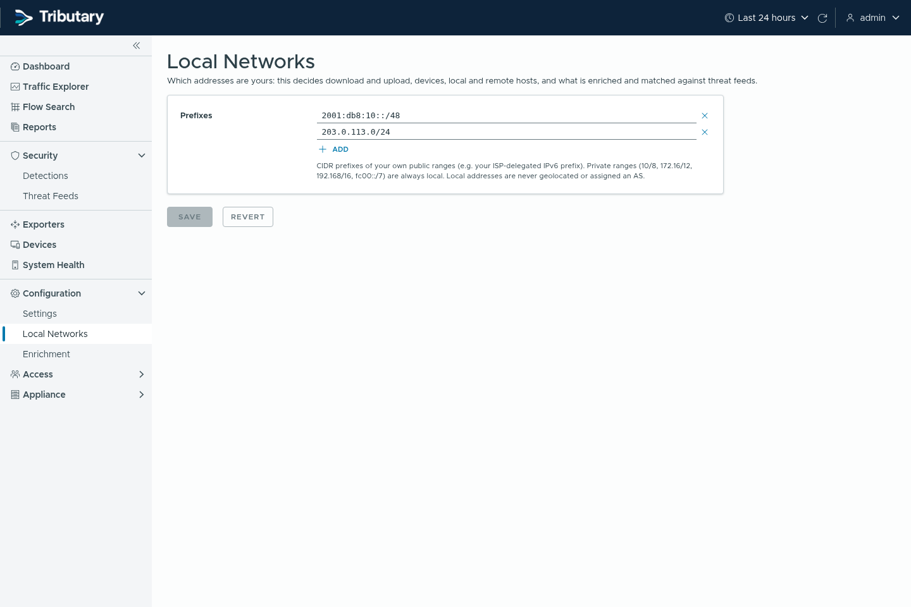
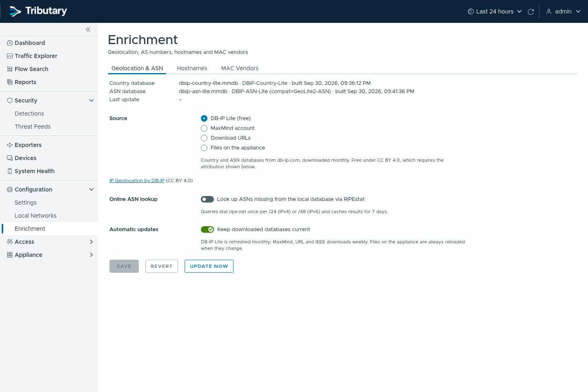

# Screenshots

Simulated traffic from `cmd/flowgen`.

| | |
|---|---|
|  Dashboard |  Dark theme |
|  Traffic Explorer |  Flow Search |
|  Traffic paths |  Interface paths |
|  Devices |  Exporters |
|  Exporter detail |  Detections |
|  Threat feeds |  Local networks |
|  Enrichment |  Sign in |
