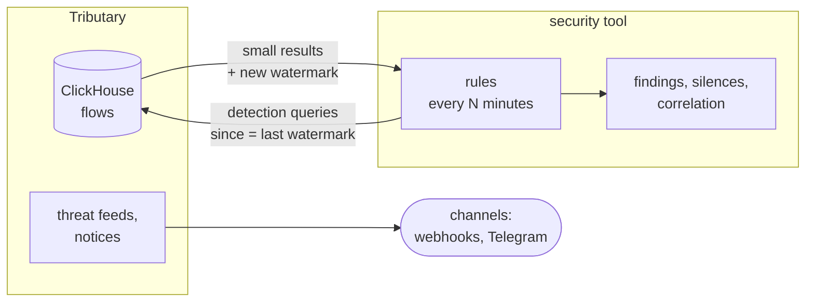

# Design: detection queries

Status: draft, October 2026. Supersedes an earlier draft of a rules engine
inside Tributary.

Tributary is the flow sensor. It keeps its own threat detection (threat
feeds, notices, both sent to channels). Rules, findings, acknowledgements and
correlation with other sources live in a separate security tool. That tool
polls Tributary every few minutes with **detection queries**: analytical
questions answered in ClickHouse, next to the data, returning small results.

## Goals

- Answer the questions detection rules ask (scans, fan-out, new pairings,
  volume, beaconing, missing traffic) without shipping raw flows.
- Incremental polling: each poll covers exactly the flows since the last
  one, with nothing missed or counted twice, across restarts on either side.
- Same queries over REST and MCP.
- Bounded cost: a misconfigured poller can't take the appliance down.

## Non-goals

- Rules, findings, state machines, silences or notification of query
  results in Tributary.
- A general query language. Queries take the Explorer's filters and
  dimensions plus a few parameters each.
- Pushing flows elsewhere (that's flow export or syslog, if ever).

## Polling

Flows are ordered by `time_received`, the time the collector received the
record. A record that an exporter sends late (active timeout) is stamped when
it arrives, so a cursor on `time_received` sees every record exactly once.
Only insert batching delays it.

- Each query takes `since` and returns `until`, the **watermark**: now minus
  the writer's flush interval plus a margin (60 s). The next poll passes it
  back as `since`.
- Without `since`, a query covers its `window` ending at the watermark.
- Queries that need a span longer than one poll interval (distinct counts
  over 5 minutes, beacons over hours) take `window`. They then cover
  `[until − window, until)`, and overlapping results are the poller's to
  deduplicate, by key.
- Every response carries `until`, `truncated` and the query's `durationMs`.

## Common parameters

| | |
|---|---|
| `filters` | Explorer filters, e.g. `direction=upload,!dst_port=443` |
| `by` | grouping dimensions: any of `store.DimensionNames()` (`local_host`, `remote_host`, `device`, `dst_port`, `remote_country`, `app`, `threat`, …), up to 3 |
| `since`, `window` | see Polling |
| `limit` | rows, default 100, at most 1,000 |

Rows name hosts as the rest of the API does (inventory, Tributary names,
reverse DNS), so the security tool never needs a second lookup for display.

## Queries

### `aggregate`: volume over a threshold

Totals per group, keeping groups at or over thresholds.

Parameters: `min_bytes`, `min_packets`, `min_flows` (any of them).

Example rule: a device uploads more than 5 GB in an hour.
`by=device, filters=direction=upload, window=1h, min_bytes=5e9`.

### `distinct`: fan-out

Distinct values of a field per group, keeping groups with at least `min`.
Returns the count and a sample of values.

Parameters: `field` (a dimension), `min`.

Example rules: inbound port scan (`by=remote_host, field=dst_port,
filters=direction=download, window=5m, min=100`); internal sweep
(`by=local_host, field=dst_addr, filters=direction=internal, min=50`).

### `first_seen`: new pairings

Groups seen since `since` that weren't seen before, with when they were
first seen.

Raw flows are kept 7 days by default, which is too short for a learning
period. Common pairings are therefore kept in **first-seen tables**:
ClickHouse materialized views into `AggregatingMergeTree` tables holding
`min(time_received)` and `max(time_received)` per key, with a 180-day TTL.
They are cheap because the number of keys stays small.

| Table | Key |
|---|---|
| `seen_country` | device, remote country, direction |
| `seen_service` | local host, protocol, local port, for inbound replies (as Exposure) |
| `seen_peer_as` | device, remote AS |
| `seen_port` | device, protocol, remote port, outbound |

`by` must match a table. Other combinations fall back to raw flows, with
the learning period limited to raw retention, and the response says so. A
table's history starts when it is created. Until it has collected a learning
period of history, responses carry `learning: true` so the tool can hold off.

Example rule: a device talks to a country it never has before.
`by=device,remote_country, filters=direction=upload`.

### `periodicity`: beaconing

For each (local host, remote host, remote port), returns the connection
count, the mean interval between connections, and the coefficient of
variation of those intervals. It keeps pairs with at least `min_count`
connections and a coefficient under `max_cv`. Records that an exporter
split at its active timeout are merged first, by start time.

Parameters: `window` (at most 24 h), `min_count`, `max_cv`.

Sampled exporters make the results unreliable, and the response says which
exporters are sampled.

### `absence`: expected traffic missing

Of the given groups (`expect`: a list of values, or `seen:<duration>` for
every group seen in that period), returns the ones with no matching flows in
`window`, along with when each was last seen.

Example rules: the backup server didn't talk to the NAS overnight; a
camera stopped sending.

### `threat_matches`

The per-host threat feed matches that already drive `threat.detected`
(`store.ThreatMatches`), with `since`. The tool can take over threat
alerting without duplicating it.

## Transport

- REST: `GET /api/detect/{query}?…`, JSON.
- MCP: the same queries as tools (`detect_distinct`, `detect_first_seen`, …),
  with descriptions written for an assistant choosing among them.
- Rows keep stable keys (addresses, port numbers, country codes) next to
  their display names, for the tool's fingerprints.

## Access and limits

- **Auth:** API tokens. The security tool uses a token of a viewer account,
  which is read-only already. A `detect` token scope can come later if
  tokens need narrowing.
- **Limits:** queries run with a 30 s timeout and at most 2 at a time per
  token (a third gets 429), and return at most 1,000 rows. Raw-flow windows
  are capped at 24 h, except `first_seen` over its tables.
- **Visibility:** System Health shows detection query counts and the
  slowest queries by token, so an expensive poller is visible.

## What stays in Tributary

- Threat feeds, Detections and `threat.detected` to channels.
- Appliance notices to channels.
- Reports.

## Phases

1. Watermark and `since`, then `aggregate`, `distinct` and `threat_matches`
   over REST and MCP, with limits.
2. First-seen tables and `first_seen`.
3. `periodicity` and `absence`.

## Open questions

- Does the security tool exist as a product yet, or is the first consumer a
  script? That decides how much of the MCP side is needed in phase 1.
- Which first-seen tables are worth having from the start? Each costs one
  materialized view on ingest.
- Should `distinct` and `aggregate` use the 1-minute rollup when the filter
  allows it (exporter, interface, protocol only)? This is rarely useful for
  detection, which is mostly per host.
