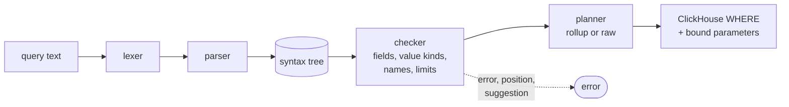

# Design: query language

Status: phase 1 implemented, October 2026 (`internal/query`,
`store.CompileQuery`, the `q` parameter and a query box beside the filter
chips); phases 2 and 3 to come. Today's filters are a set of fields, each with
a comma-separated list of values. They are combined with AND, and each field
can be used once. This design replaces them with a typed query, closer to
Graylog than to a form:

```
src:10.0.0.0/8 AND dst_port:[1 TO 1023] AND NOT country:(US OR CA)
host:nas AND host:203.0.113.9
bytes:>100MB AND direction:upload
threat:* OR (remote_country:RU AND dst_port:3389)
flags:syn AND NOT flags:ack
device:"Living room TV" AND NOT app:tcp/443
```

The same query works everywhere: the Traffic Explorer, Flow Search,
Detections, reports, the MCP tools, CSV export and the
[detection queries](DETECTION-QUERIES.md).

## Goals

- `AND`, `OR`, `NOT` and parentheses across any fields, and the same field
  more than once.
- Network values typed as themselves: IPv4, IPv6, CIDRs, MACs, port and
  address ranges, sizes and durations, with no quoting.
- Names wherever an address or device goes (`host:nas`), resolved the way
  Tributary already names hosts.
- Mistakes are reported: unknown fields and wrong value types are errors,
  and unknown names are warnings, all with a position and a suggestion.
- One parser and compiler in Go. The UI never re-implements the grammar.
- Today's filters keep working, and convert to queries without changing
  their meaning.

## Non-goals

- Full-text search. Flows have no free text.
- Pipes and aggregation (`| stats sum(bytes) by host`). Grouping and
  totals are the Explorer's and the detection queries' job.
- SQL passthrough, or anything that reaches ClickHouse without going
  through the field table.
- Wireshark compatibility. Some Wireshark names work as aliases (see
  Fields), but this isn't Wireshark's grammar.

## Syntax

| | Example |
|---|---|
| field and value | `dst_port:443` |
| several values (any) | `dst_port:(80 OR 443)` |
| range, inclusive | `dst_port:[1 TO 1023]`, `dst_port:1-1023`, `bytes:[1MB TO 10MB]` |
| open range | `bytes:[100MB TO *]` |
| comparison | `bytes:>100MB`, `packets:<=3`, `duration:>=5m` |
| not | `NOT country:US`, `!country:US`, `country:!US` |
| and | `a AND b`, `a && b` |
| or | `a OR b`, `a \|\| b`, or just `a b` |
| grouping | `(a OR b) AND c` |
| any value present | `threat:*`, `vlan:*` |
| quoted value | `device:"Living room TV"` |
| bare value | `10.0.0.5`, `10.0.0.0/8` or `nas` means `host:…`; a bare number is an error |

`AND` binds tighter than `OR`, and `NOT` binds tightest. Keywords are case
insensitive. Terms written next to each other are combined with **OR**, as
in Graylog and Lucene: `host:a host:b` is either host, and `host:a host:b
AND port:22` is `host:a OR (host:b AND port:22)`.

A bare number fails with "a number alone isn't a host: use `port:443` or
`dst_port:443`", because it could mean a port, an AS or a VLAN.

### Grammar

```ebnf
query      = [ or ] ;
or         = and { [ "OR" | "||" ] and } ;      (* adjacent terms: OR *)
and        = unary { ( "AND" | "&&" ) unary } ;
unary      = ( "NOT" | "!" ) unary | primary ;
primary    = "(" or ")" | term ;
term       = field ":" match | value ;            (* a bare value is host:value; not a number *)
match      = [ "!" ] ( value | range | compare | "*" | "(" values ")" ) ;
values     = value { ( "OR" | "||" ) value } ;
range      = ( "[" bound "TO" bound "]" ) | value "-" value ;
bound      = value | "*" ;
compare    = ( ">" | ">=" | "<" | "<=" ) value ;
value      = address | cidr | mac | number | size | duration | word | string ;
```

### Values

The lexer reads a value by its shape, after a `:`, a comparison, a range
bracket or at the start of a bare term. This is what lets
`host:2001:db8::1` and `src:10.0.0.0/8` work unquoted, where Lucene-style
grammars need quotes.

| Kind | Examples |
|---|---|
| address | `10.0.0.5`, `2001:db8::1`, `::ffff:10.0.0.5` |
| CIDR | `10.0.0.0/8`, `2001:db8::/32` |
| address range | `10.0.0.10-10.0.0.20` |
| MAC | `aa:bb:cc:dd:ee:ff`, `aabb.ccdd.eeff`, `aa-bb-cc-dd-ee-ff` |
| number | `443`, `65001` |
| size | `512`, `100KB`, `1.5MB`, `2GiB` (KB = 1000, KiB = 1024) |
| duration | `500ms`, `30s`, `5m`, `2h` |
| word | `nas`, `tcp`, `US`, `upload`, `Spamhaus` |
| string | `"Living room TV"`, `"Spamhaus DROP (IPv4)"` |

## Fields

The existing filter fields keep their names. The new fields are per flow
record: `bytes:>100MB` matches records over 100 MB, not hosts with 100 MB
in total.

| Field | Values | Aliases | |
|---|---|---|---|
| `host` | address, CIDR, range, name | `ip`, `addr`, `ip.addr` | either side |
| `src`, `dst` | as host | `ip.src`, `ip.dst` | |
| `local`, `remote` | as host | | the local or remote side (local networks) |
| `nexthop` | address, CIDR | | |
| `port` | number, range | `tcp.port`, `udp.port` (also set the protocol) | either side |
| `src_port`, `dst_port` | number, range | `sport`, `dport` | |
| `proto` | name or number | | `tcp`, `udp`, `icmp`, … |
| `app` | `proto/port` | | the application side of the flow |
| `exporter` | address, name | | |
| `iface`, `in_if`, `out_if` | index (interface names later) | | |
| `as`, `src_as`, `dst_as`, `remote_as` | number, `AS` + number | | |
| `country`, `src_country`, `dst_country`, `remote_country` | ISO code | | |
| `direction` | `download`, `upload`, `internal`, `transit` | `in`, `out` | |
| `device` | name, MAC, address | | the local device (MAC) |
| `mac`, `src_mac`, `dst_mac` | MAC | `eth.addr`, `eth.src`, `eth.dst` | as exported |
| `threat` | feed name or ID, `*` | | either side listed |
| `vlan`, `dscp`, `etype`, `flow_type` | as today | | |
| `bytes`, `packets` | size / number, comparisons | | per record, sampling-corrected |
| `duration` | duration, comparisons | | `time_end − time_start`, to the second (flows store seconds) |
| `flags` | `fin`, `syn`, `rst`, `psh`, `ack`, `urg`, `ece`, `cwr` | | the TCP flag is set |
| `sampling` | number, comparisons | | |

`peer` is kept as an alias of `host`. With a real `AND`, `host:a AND
host:b` already means "between a and b".

### Names

A name where an address goes resolves, when the query is compiled, to every
address that has that name. The sources are the inventory, names set in
Tributary (exporters, devices) and the reverse DNS cache, in the usual order
of precedence. `device:` names resolve to MACs. Threat feed names resolve
to IDs.

- If a name matches nothing, that term matches nothing and the query runs
  with a warning: `no host named "nass" · did you mean "nas"?`. The query
  bar shows the warning underlined, and the API returns it next to the
  results.
- If a name matches more than 256 addresses, the query fails with a request
  to use a CIDR instead.
- Matching ignores case and requires the whole name, or the first label
  of a DNS name (`nas` matches `nas.home.lan`). `host:nas*` matches by
  prefix.

## Processing



- **Checker and compiler** (`store.CompileQuery`) check each term against
  the field table and produce the `WHERE` fragment with `?` parameters.
  Plain values of the classic fields go through the same conditions as the
  filters (`FilterFields`), so a converted filter compiles to identical
  SQL; the new forms (comparisons, ranges, names, `*`) are added around
  them. No value is ever pasted into SQL.
- **Planner:** if every field in the tree can use the rollup table, the
  existing rule applies (more than three hours, rollup columns only).
- **Limits:** at most 2,000 characters, 64 terms, 100 values in a list and
  nesting 16 deep. A query past them fails with a clear message.
- **Canonical form:** the compiler can print a query back in a standard
  form (`dst_port:(80 OR 443) AND NOT country:US`). That form is what gets
  saved, compared and shown in links.

### Errors and warnings

Both carry a message, the position and length of the part concerned, and a
suggestion when there is one. An error stops the query; a warning doesn't.

| Query | |
|---|---|
| `dst_prot:443` | unknown field `dst_prot` · did you mean `dst_port`? |
| `dst_port:https` | `dst_port` takes a port number or range |
| `src:10.0.0.0/33` | invalid prefix length 33 |
| `bytes:>lots` | `bytes` takes a size such as `100MB` |
| `443` | a number alone isn't a host: use `port:443` or `dst_port:443` |
| `host:nass` | warning: no host named `nass` · did you mean `nas`? (matches nothing) |
| `(a OR b` | missing `)` |

## API

- Every endpoint that takes filters also takes `q`. When both are given,
  they are combined with AND, so old links and scripts keep working.
- `GET /api/query/check?q=…` returns the canonical form and any warnings,
  or the error, with positions, always with status 200: an invalid query
  is a successful check. Positions count UTF-16 units, as browsers do.
- Other endpoints answer an invalid query with 400 and the same error
  object, and carry warnings in an `X-Query-Warnings` header (a JSON
  array), so no response body changes shape. MCP returns them as
  `{"result": …, "warnings": […]}`.
- (Phase 2) `GET /api/query/suggest?q=…&pos=n` returns completions at
  the cursor: field names, or values for the field (exporters, devices,
  feeds, countries, protocols, recently seen hosts).
- MCP tools take `query`, and their description includes a short syntax
  guide. `filters` stays for existing clients.
- Saved reports convert their filters to a query once, on upgrade. Each
  `key=v1,v2` becomes `key:(v1 OR v2)` and `!` becomes `NOT`. The report
  then stores a `query`.

## UI

- **Query bar:** a one-line [CodeMirror 6](https://codemirror.net/) editor
  in a small Angular wrapper, replacing the filter chips on the Explorer,
  Flow Search and Detections.
  - Highlighting comes from a small tokenizer (`StreamLanguage`), which
    only colours fields, operators and values. Parsing stays in Go.
  - Completions come from `/api/query/suggest` (`@codemirror/autocomplete`).
  - Errors come from `/api/query/check`, debounced, and are underlined in
    place (`@codemirror/lint`).
  - Enter runs the query, and the query is kept in the page's URL.
- **Click to filter:** clicking an address, port or country in the results
  adds `AND field:value`, and Alt-click adds `AND NOT field:value`.
- **History:** recent queries per user in the browser, with ↑ in an
  empty bar.
- **Help:** a `?` popover with the syntax table and examples.
- **Reports:** the report editor uses the same bar.

CodeMirror loads only with the pages that use the bar.

## Implementation

- **Parser:** hand-written recursive descent, chosen over a
  [participle v2](https://github.com/alecthomas/participle) prototype.
  participle needed a fragile IPv6 regular expression ahead of its word
  rule, let `AND` through as a value (`port:(1 AND 2)`) without extra
  keyword handling, and reports errors as grammar dumps
  (`unexpected token "<EOF>" (expected ("*" | ("(" …`) with no span to
  underline. The hand-written parser decides by shape: a word that is an
  address, prefix, range or MAC as a whole is a value, otherwise the part
  before its first colon is the field. Libraries
  for Lucene and AIP-160 syntax were considered and rejected: their lexers
  need IPv6 addresses and CIDRs quoted, none outputs ClickHouse, and the
  field semantics have to be written here regardless.
- **Packages:** `internal/query` holds the lexer, parser and printer;
  the checker and compiler are in `internal/store`, next to the columns.
- **Tests:**
  - table tests from query to canonical form and to SQL, and from query to
    error and position;
  - every legacy filter converted and compared against the old SQL;
  - fuzzing, as for the flow decoders, so no input can panic or produce
    invalid SQL.

## Phases

1. `internal/query`, the compiler and the `q` parameter, with
   `/api/query/check` and the MCP `query` argument. The pages keep their
   chips, and a query box sits alongside them.
2. The query bar (CodeMirror), suggestions, and moving the Explorer, Flow
   Search, Detections and reports over. The chips are removed.
3. Saved queries, and the detection queries built on `q`.

## Saved queries

A saved query has a name, the query in canonical form, an owner and a
**shared** switch. Private ones are seen only by their owner; shared ones
by everyone, and only the owner (or an administrator) can change or delete
them. They are listed in the query bar's menu and in MCP (`saved_queries`).

| Column | |
|---|---|
| `id`, `name` | |
| `query` | canonical form |
| `owner` | username |
| `shared` | 0 or 1 |
| `created_at`, `updated_at` | |

## Decisions

- Adjacent terms mean OR, as in Graylog and Lucene.
- A bare number is an error, not a port.
- An unknown name matches nothing, with a warning.
- Saved queries are private, with a switch to share them.
